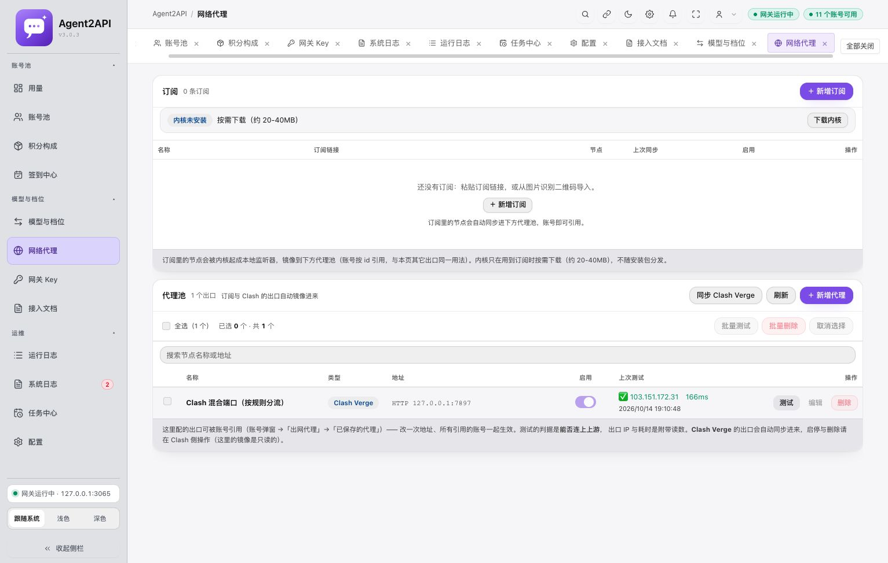

# 网络代理恢复上游 3.0.3 方式

后续真实订阅测试发现上游监听器引用 provider 节点的问题，已修复并重启生效；最新内核与现场节点验证见 [订阅转发修复记录](SUBSCRIPTION-ROUTING-FIX.zh-CN.md)。本文的“无订阅、未安装内核”是本次恢复时的历史状态。

实施日期：2026-10-14。根据用户明确选择“移除独立节点增强，恢复上游原有代理方式”，本次调整网络代理与订阅相关实现。此前的上游同步报告保留为历史记录；涉及独立节点、测试数量和当前服务状态时，以本文为准。

## 当前行为

- 订阅沿用上游 3.0.3 的订阅管理、二维码导入、按需下载 mihomo、节点镜像到代理池和账号按 ID 引用方式。
- Clash Verge 沿用上游读取 `verge.yaml` 混合端口和已配置监听器的方式。移除 Agent2API 自建独立节点内核、节点监听器与 `__node__:` 镜像扩展。
- 保留 macOS Application Support 配置目录识别、代理搜索、后台执行同步和同步错误显示。这些增强与原有代理方式兼容。
- 其他品牌、账号管理、Key 配额、Accio 修复和请求阶段耗时功能继续保留。

现有代理池从 47 项变为 1 项：`Clash 混合端口（按规则分流）`，地址 `HTTP 127.0.0.1:7897`。移除的 46 项均为独立节点增强生成的镜像；修改前核对了账号和代理池以外的配置引用，没有账号或其他配置引用这些 ID。11 个账号的代理设置没有改变。

使用 Clash 混合端口时，实际节点和规则由 Clash Verge 控制。需要由 Agent2API 管理订阅节点时，可使用上方原有订阅入口。当前没有订阅，订阅内核没有安装。

## 并发写入修复

代理池原本使用整份 JSON 读改写；订阅同步、Clash 同步、手工编辑或测试结果同时写入时可能互相覆盖。现在所有代理池修改都在 SQLite `BEGIN IMMEDIATE` 事务内完成读改写，对独立数据库连接同样生效。损坏的存储或失败的修改不会覆盖原有数据。网络请求和日志写入位于该事务之外。

新增回归使用 8 个独立数据库连接并发修改，验证 128 次计数更新和手工、Clash、订阅三种来源全部保留。HTTP 回归并发执行 24 次手工创建和 16 次 Clash 同步，验证订阅夹具仍存在、没有生成独立节点镜像。

## 构建与验证

| 检查 | 本次结果 |
| --- | --- |
| 服务端 Rust 测试 | 536 通过，0 失败，6 忽略；另有 1 条文档测试忽略。数量下降包含移除独立节点模块测试 |
| 上游 3.0.3 HTTP 回归 | 134 项检查通过，使用临时数据库和本地夹具 |
| AIBuddy HTTP 回归 | 113 项断言通过 |
| 服务端构建、macOS 桌面 cargo check | 通过 |
| UI 类型检查与 Vite 构建 | 通过，产物已更新 |
| i18n 扫描、构建、缺失键检查 | 通过 |
| git diff --check | 通过 |
| 真实本机页面 | 显示 v3.0.3、1 个出口、0 条订阅、11 个账号可用 |
| 真实混合端口测试 | 2026-10-14 19:10:48 通过，出口 IP `103.151.172.31`，166ms |

真实页面和混合端口测试已经验证；未下载订阅内核，也没有用真实订阅进行 mihomo 节点端到端测试。没有发布安装包或 GitHub Release，本次源码修改尚未提交或推送。

## 重启与备份

本机 `127.0.0.1:3065` 已使用新二进制重启，旧 PID 92509 → 新 PID 99894，健康检查返回 `status: ok`。启动时保留既有环境变量，没有在报告中记录密钥。重启前确认没有正在处理的请求。

- 修改前源码差异、副本和一致性数据库快照：`data/update-backups/proxy-alignment-20261014-185827/`。
- 停机前另存数据库：`data/local/backups/pre-proxy-alignment-20261014-190758.db`。
- 旧独立节点运行目录已移至上述源码备份目录的 `runtime-clash-nodes/`，用于恢复；没有修改 Clash Verge 自己的配置。
- 重启结果：`data/local/proxy-alignment-result.json`。
- 当前二进制：`target/debug/agent2api-server`，SHA-256 `a0cacd9a60f55feadbcfd93aa8358606358a5a6cfbf7b55a40a4dab382fb9bc6`。

备份位于 Git 忽略目录，数据库备份权限为 0600。恢复时应先停止服务并核对后续新增数据，避免整库覆盖后续状态。
