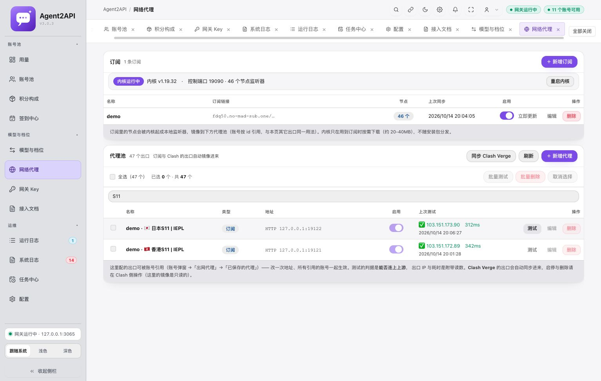

# 订阅节点测试立即失败：原因与修复

日期：2026-10-14。

## 原因

真实本机 `proxy-kernel/kernel.log` 在 19:50:39–19:50:59 连续记录 `[Metadata] parse failed: proxy <节点名> not found`，与页面显示的 1–3ms 失败对应。内核在运行、订阅已读取 46 个节点，但监听器的 `proxy` 字段直接引用了订阅集合里的节点名。该名称没有注册为全局出站，mihomo 在本地拒绝转发，所以这些测试不能证明远端节点不可用。

上游 3.0.3 的 `sub_kernel/runtime.rs::build_config` 使用了这一配置形式。此前测试覆盖订阅 CRUD、镜像和内核状态，没有安装真实 mihomo 验证订阅转发链，因此未发现这处问题。

官方说明：[监听器 proxy 字段](https://wiki.metacubex.one/en/config/inbound/listeners/)必须引用合法出站或策略组；[策略组 use 字段](https://wiki.metacubex.one/en/config/proxy-groups/)用于引入订阅集合。

## 修复

每个节点新增一个稳定名称的策略组；监听器引用策略组，策略组通过 `use` 引入所属订阅，并以转义后的完整节点名过滤。不同订阅的同名节点不会混用。节点为空时使用 `REJECT`，不回落到直连。

节点端口、代理池 ID 和账号引用的契约保持不变；未恢复已移除的 Clash 独立节点增强。

## 验证

- 配置单元测试：验证带 emoji、方括号、括号、点、加号、竖线的节点名精确匹配，并验证订阅隔离。
- 真实已安装 mihomo v1.19.32 转发回归：使用临时配置、两个本地 HTTP CONNECT 出站夹具以及同名节点，验证两个监听器分别收到各自出站的响应；测试通过，没有访问真实订阅或外部服务。
- 全量 Rust 测试串行执行：537 通过、0 失败、7 忽略，另有 1 条文档测试忽略。上述真实内核回归单独执行并通过。
- 并行全量测试出现一项既有请求阶段耗时测试失败（`stage_timings_survive_live_updates_and_disconnect_persistence`，共享状态字段为 Null）；串行完整复核通过。订阅配置测试未失败。这项并行测试稳定性问题仍待独立处理。
- 服务端构建通过，`git diff --check` 通过。

## 备份

修改前内核配置、状态及上游源码副本：`data/update-backups/subscription-routing-20261014-195728/`。配置与状态含私有字段，备份文件权限为 0600，不进入 Git。

重启前另做一致性数据库备份，结果记录在 `data/local/subscription-routing-result.json`；不修改订阅和账号数据。

## 真实服务生效结果

先通过本机认证控制器热加载修复配置，确认 46 个策略组各自只有一个有效节点。主服务有直连流式请求时保持运行；20:04:03 等到没有请求的窗口后完成重启，PID 99894 → 9379，健康检查 `status: ok`。重启前备份为 `data/local/backups/pre-subscription-routing-20261014-200403.db`。

重启后的控制器再次确认 46 个策略组都有效，节点端口注册表与修改前一致。数据库仍有 47 个代理出口，其中 46 个为订阅节点；11 个账号保留。统计记录见 `data/local/subscription-routing-live.json`。

| 现场复测节点 | 出口 IP | 耗时 | 时间 |
| --- | --- | --- | --- |
| 日本 S11 | `103.151.173.90` | 312ms | 20:06:27，主服务重启后再次测试 |
| 香港 S11 | `103.151.172.89` | 342ms | 20:01:28，热加载后测试 |
| 新加坡 S01 | `188.253.121.66` | 4.8s | 20:02:16，热加载后测试 |

当前二进制 SHA-256：`73f0c203dbe3139ff875bd67f29d3133e094e87c2e9bba0ecae004f43995bf6a`。

此前失败结果仍保留在未复测的条目上，只有重新测试才会更新。没有测试全部 46 个真实节点，以上三个成功不能代表所有节点可用。源码和测试已修改，未提交或发布。

