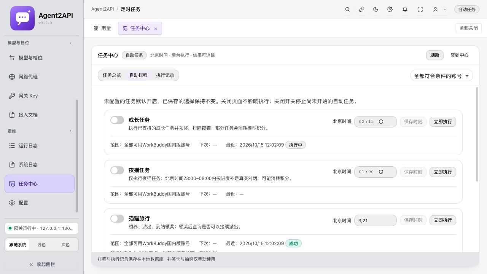
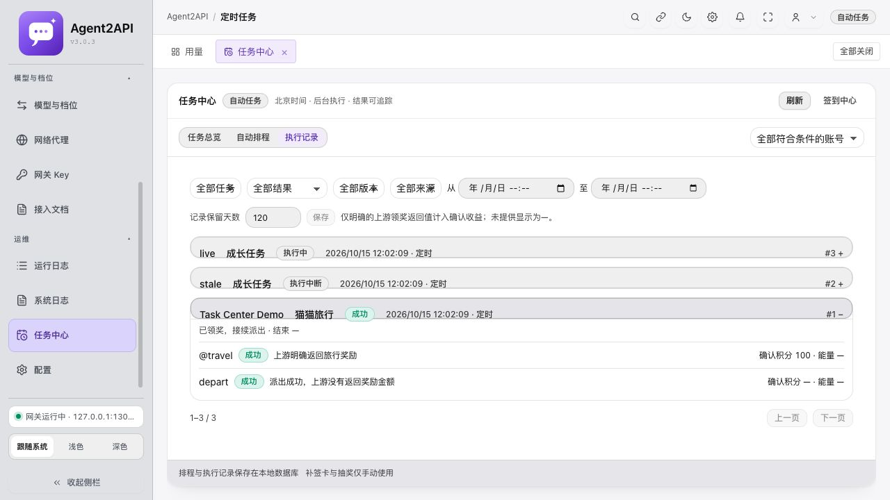
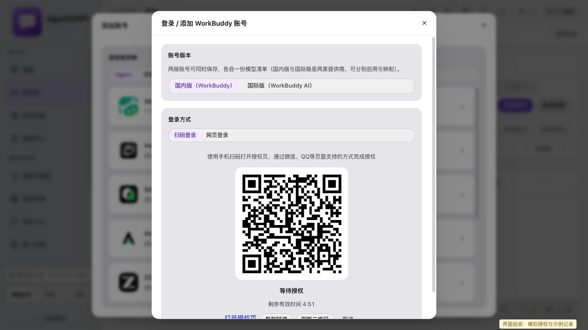
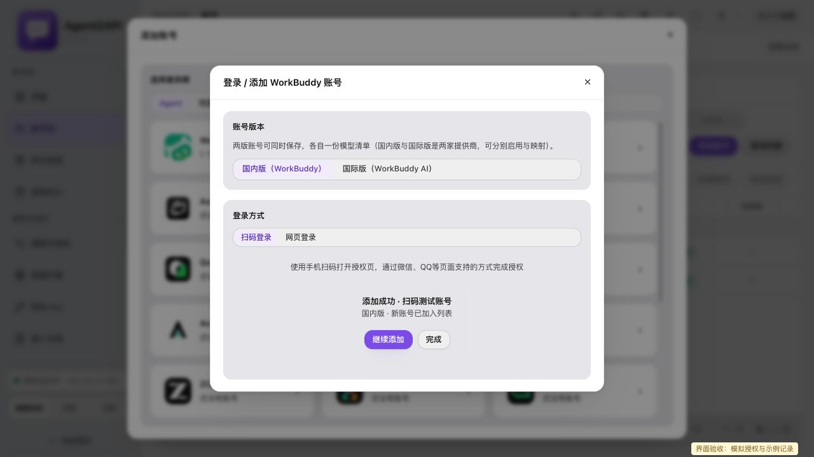

# WorkBuddy 扫码添加与任务中心交付说明

本次实现复用 Agent2API 的 Rust 网关、SQLite、账号存储和 React Islands。桌面 IPC 与 Web 面板使用相同管理接口和后台任务服务，没有引入 Python 业务服务或第二套账号系统。

代码与隔离验证已完成。真实腾讯扫码、旅行到账、当天活跃计入和夜猫真实对话尚未验收。下文截图中的二维码、授权成功与奖励记录均为模拟数据，不代表真实上游授权或收益。

## 使用入口

1. 添加账号 → WorkBuddy → 国内／国际版 → 扫码登录。网页登录仍可切换使用。
2. 扫码区提供授权页链接、复制、刷新、取消、倒计时；手机可以直接打开授权页。
3. 授权成功展示账号摘要，选择继续添加才开始新一轮。重复登录更新凭证并保留自定义名称、备注、代理、优先级、启停状态及扩展字段。
4. 任务中心分为任务总览、自动排程、执行记录。账号页保留任务详情，签到中心的成长任务入口跳转任务中心。
5. 单账号可查询任务、执行普通成长、独立夜猫、旅行、活跃和奖励；补签昨日与抽奖一次为独立手动按钮。通用定时任务位于系统维护区域。

关闭前端不停止后台排程。停止按钮在当前上游请求完成后阻止后续写步骤；关闭开关也会阻止该自动任务后续动作。执行中的队列每三秒回读，页面重新打开可接管服务端进度。

## 默认排程与迁移

| 类型 | 北京时间 | 行为 |
| --- | --- | --- |
| 普通成长 | 01:00 | 仅已有协议支持且上游下发的任务，排除 black_cat |
| 夜猫 | 01:00 | 仅 black_cat；23:00 至次日 08:00 允许新对话步骤，可能消耗积分 |
| 猫猫旅行 | 09:00、21:00 | 查询猫档案和旅行状态，领养、派出、到站领奖后尝试接续派出 |
| 活跃 | 10:00 | 每账号一条事件；约 2、5、10 秒验证，不补发事件或真实模型对话 |
| 奖励管家 | 10:00 | 领取礼包、补偿、达标档位和任务奖励；签到及合适的成长任务完成后也检查 |

缺失开关默认开启；已保存的 false 和时刻保留。规范化配置存入 `task_state` 的 `growthSchedule`，标记 `defaultsVersion=2`。部分 PUT 只合并允许写入的字段；执行游标、摘要和运行结果不能由客户端写入。签到设置不改动。

数据库升级为 schema 12，通过现有事务迁移增加 `task_runs` 与 `task_run_items`。历史表不引用账号外键，删除账号后保留昵称快照和执行事实。现有签到历史保留原表。

后台约每三十秒检查，统一 UTC+8，不依赖宿主时区。每账号、任务类型、北京日期与计划时点使用数据库唯一槽位去重。启动只补当天已错过的时点；旅行只补最近一个，夜猫窗口外不补发对话。自动账号并发为一，手动支持一至四，同一账号通过进程锁与可续期数据库租约串行。

运行租约过期才标记执行中断，活跃恢复只查询、不会重发事件，成长恢复只回查和领奖，避免重放结果不明的付费对话。只读查询可有限退避；写操作失败后再次触发前先查当前状态。对话超时记为待核实，不能据此直接重发。

## 结果与奖励口径

- 成功、已完成／已领取、正常跳过、已提交待验证、失败、取消和中断分别记录。
- 已派出、在途、缺记录编号、未解锁或未知状态均有说明；不盲目调用写接口。
- 国内版以当天热力图等可验证信息判断活跃。累计连登天数不能证明当天成功；国际版暂无当天验证能力时保留待验证状态，并只调用国际版上报域名。
- 自动奖励路径不使用补签卡、不抽奖。仅手动按钮和明确手动的兼容接口使用这些权益。
- 上游明确返回的奖励才记录确认积分／能量。未提供为 null，界面显示 `—`，不按零记账，不使用任务标称奖励代替到账值，不把余额变化归属某项任务。
- 记录保存失败会显示或记录“结果已执行，记录保存失败”，不会因此重做上游动作。
- 默认保留九十天，可在记录页修改为一至 3650 天。分页默认五十、最多二百，支持账号、版本、类型、来源、结果和北京时间范围筛选。
- 历史与登录成功响应不返回 Token、完整授权链接、二维码或对话正文。管理接口要求管理会话，推理 API Key 无权访问任务和扫码管理。

## 接口

| 接口 | 用法 |
| --- | --- |
| POST /api/session/login/start | 原参数兼容，返回 state、authUrl、expiresAt |
| GET /api/session/login/wait | 原 pending/done/error 兼容，增加阶段、错误分类，完成只含账号摘要 |
| POST /api/session/login/cancel | 按 state 取消，与保存提交串行；保存完成后不能撤销账号 |
| GET / PUT /api/growth-tasks/schedule | 配置、运行摘要、最近结果、下次时刻、记录保留天数 |
| POST /api/growth-tasks/run | 可选 accountId、taskKind、mode、concurrency；kind 为 growth/night/travel/activity/rewards，mode 为 full/claim |
| GET /api/growth-tasks/queue | 实时进度、runId、任务类型、步骤与错误摘要 |
| POST /api/growth-tasks/stop | 空对象停止队列；runId 停指定运行 |
| GET /api/task-records | limit/offset、accountId/provider/kind/source/outcome/from/to 筛选 |
| GET /api/task-records/{id} | 主记录和步骤、明确的奖励金额及来源 |
| POST /api/growth-tasks/rewards | 手动 makeup 或 lottery，要求国内版 accountId |

旧成长任务入口保留，统一调用任务执行服务。扫码沿用五分钟等待和十分钟结果保留，不新增公开或跳过鉴权的扫码接口。刷新与切换版本先取消旧轮次，旧响应不能覆盖新界面。

## 可重复验证

在仓库根目录运行：

```sh
npm run build --prefix desktop-tauri/ui-islands
node scripts/test-workbuddy-tasks.mjs
node scripts/test-web-login-lifecycle.mjs
node scripts/test-workbuddy-qr-lifecycle.mjs
cargo test --manifest-path desktop-tauri/src-tauri/server/Cargo.toml --lib -- --test-threads=1
cargo build --manifest-path desktop-tauri/src-tauri/server/Cargo.toml --bin agent2api-server
python3 scripts/test-workbuddy-task-center.py
cargo check --manifest-path desktop-tauri/src-tauri/Cargo.toml -p workbuddy-proxy-desktop
```

接口回归脚本使用临时 home、临时 SQLite 和未使用的本机端口，结束自动清理。不会读取真实账号。Rust 模拟上游测试需要允许绑定本机测试端口。

如需复现界面验收，先执行 `python3 scripts/test-workbuddy-task-center.py --serve`，再执行 `python3 scripts/serve-workbuddy-qr-fixture.py`。前者在 13075 提供隔离服务，后者在 13076 代理并模拟授权轮次，同时阻止上游操作路由。测试面板用户名 `task-fixture`，密码 `task-center-fixture-only`，仅用于临时隔离服务。二维码指向本机模拟页面，只能验证界面流程，不能用于真实手机登录。脚本不是产品运行依赖。

## 本次验证结果

| 验证 | 结果与边界 |
| --- | --- |
| Rust 完整串行测试 | 561 通过、0 失败、7 忽略；含夜猫边界、跨时区跨日、旅行状态机、活跃只报一条、国际版域名、奖励策略、登录生命周期及队列结果聚合 |
| 前端 | TypeScript 检查与 Vite 生产构建通过 |
| 既有契约 | 单账号范围、任务状态和错误传播、网页登录生命周期脚本通过；新增扫码组件真实 effect 测试覆盖版本切换、慢响应、取消保存竞态与关闭 |
| headless 接口及数据库 | 58 项断言通过，覆盖默认开启、保留显式关闭及时刻、输入校验、权限、SQLite 去重、中断与有效租约、重启、历史与奖励 null、保留期配置、重复登录保留扩展字段 |
| 桌面端 | Tauri cargo check 通过；没有重启现有桌面会话，未完成桌面真人扫码验收 |
| Web 界面 | 隔离服务检查任务总览、排程、记录展开；模拟扫码生成、取消、刷新、授权成功、继续添加和切换国际版轮次通过 |
| 真实上游 | 扫码、旅行到账、活跃当天计入和夜猫真实对话均未验证 |
| 手机窄屏 | 使用弹性布局及折行样式；浏览器尺寸覆盖未生效，未宣称手机实机验证通过 |

并行全量测试曾有一项已有请求计时测试失败，串行全量复测通过；未修改该计时测试。构建保留既有 Kuku 平台相关 dead_code 警告。

本轮没有重启 3065 的现有服务，没有发布版本或部署远程服务器。需要启动最终二进制后，现有运行实例才会使用新后端。首次启用缺失配置会触发当天补跑，这是已确认的产品规则。

## 界面证据

以下均来自隔离 Web 面板。排程截图中开关关闭是测试保留用户配置的结果，不代表产品默认关闭。









## 真实运行验收

使用最终桌面版本和隔离 headless 服务分别完成以下步骤，并记录实际日期、账号版本及运行编号；真实二维码不可写入报告：

1. 用户在手机完成真实授权，确认新增或更新账号、保留设置；刷新和取消旧轮次后核对没有额外账号落库。
2. 手动执行旅行巡检，对照上游实际空闲／在途／到站状态，核对奖励仅在明确返回时记录。
3. 执行活跃上报，检查只有一条事件、没有模型请求；确认当天状态或保留待验证。
4. 在北京时间允许窗口执行独立夜猫，确认仅 black_cat 按差额对话、窗口结束停止新对话，并核对实际积分影响。
5. 关闭前端等待排程，重启后核对记录仍可查、槽位不重放、账号删除不抹掉历史。

没有完成这些步骤前，模拟测试和构建结果不能作为真实上游到账或跨端运行验收的替代。
